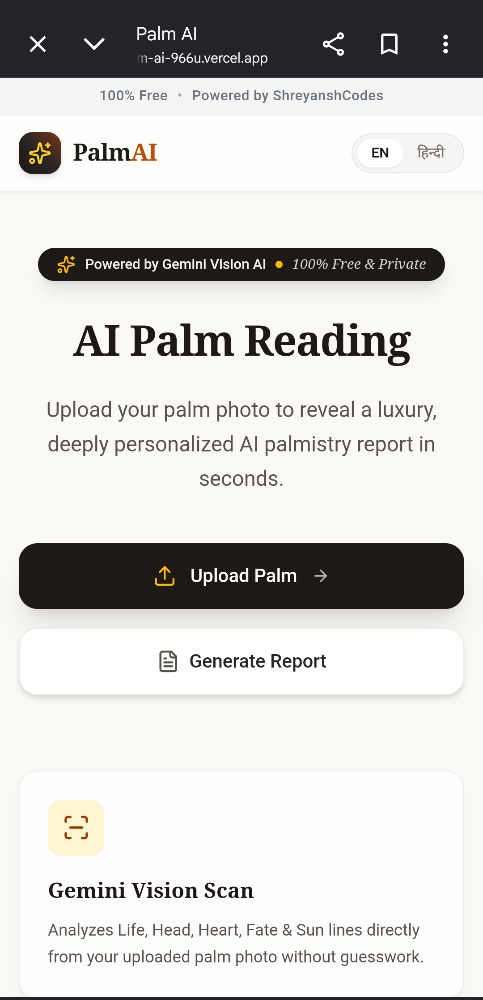
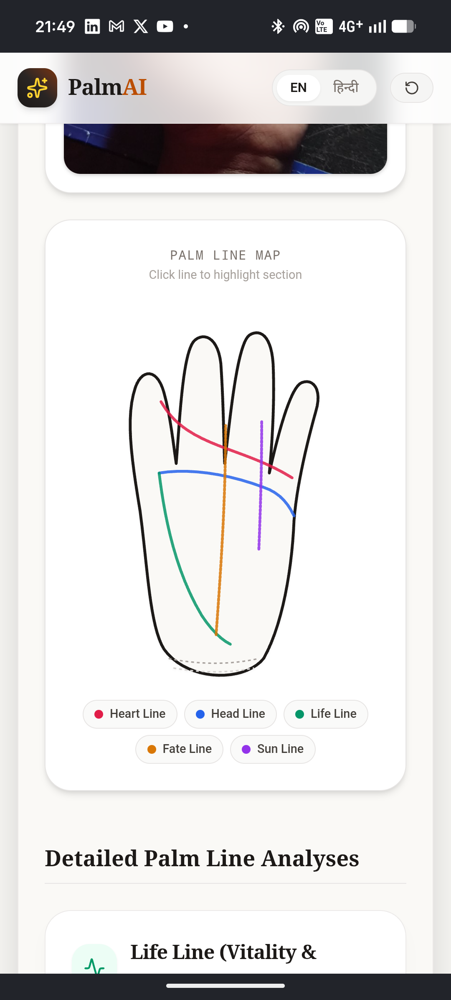
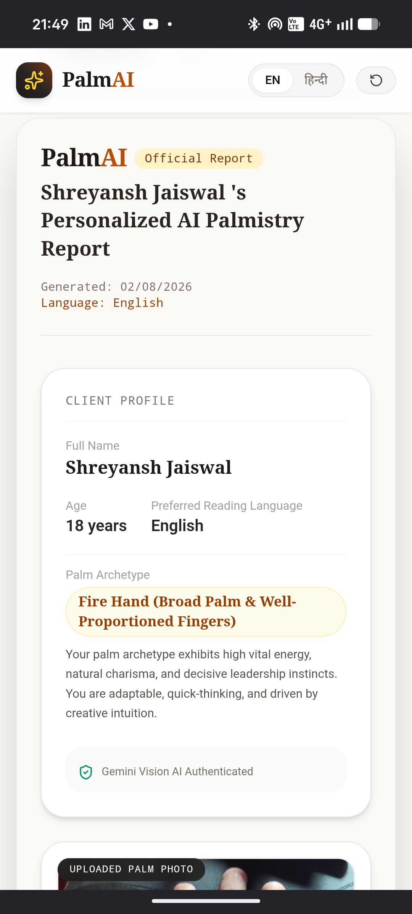

# 🖐️ PalmAI – Luxury AI Palmistry Engine

<p align="center">
  
</p>

<p align="center">


</p>

<h3 align="center">
🚀 AI Powered Palm Reading Platform
</h3>

<p align="center">
100% Free • Powered by <b>ShreyanshCodes</b>
</p>

---

## 📖 About

PalmAI is a premium AI-powered web application that analyzes a user's palm image using **Google Gemini Vision AI** and generates a beautiful palm reading report in **English or Hindi**.

Simply upload your palm, choose your preferred language, and receive a luxury infographic report with downloadable PNG and PDF support.

---

## ✨ Features

- 🖐️ AI Palm Reading
- 🤖 Gemini Vision AI
- 🌍 English & Hindi Support
- 📄 Luxury Report Generation
- 🎨 Apple Inspired UI
- 📥 PNG Download
- 📄 PDF Download
- ⚡ Lightning Fast
- 📱 Mobile Responsive
- 🔒 No Login Required
- 💯 Completely Free

---

## 📸 Screenshots

### Landing Page



---

### AI Analysis



---

### Generated Report



---

## 🧠 AI Workflow

```text
User Uploads Palm
        │
        ▼
Gemini Vision AI
        │
        ▼
Palm Analysis
        │
        ▼
Luxury Report Generator
        │
        ▼
PNG / PDF Export
```

---

## 🛠 Tech Stack

| Category | Technology |
|----------|------------|
| Frontend | Next.js 15 |
| Language | TypeScript |
| Styling | Tailwind CSS |
| UI | shadcn/ui |
| Animation | Framer Motion |
| AI | Gemini 2.5 Flash Vision |
| Backend | Next.js API Routes |
| PDF | jsPDF |
| Image Export | html-to-image |
| Icons | Lucide React |
| Deployment | Vercel |

---

## 🌐 Languages

- 🇬🇧 English
- 🇮🇳 हिन्दी

---

## 📂 Folder Structure

```bash
PalmAI/
│
├── app/
├── components/
├── hooks/
├── lib/
├── public/
│   └── assets/
│       ├── featured-image.png
│       ├── landing-page.png
│       ├── analysis.png
│       └── report.png
├── styles/
├── types/
└── README.md
```

---

## 🚀 Installation

```bash
git clone https://github.com/ShreyanshCodes/PalmAI.git
```

```bash
cd PalmAI
```

```bash
npm install
```

Create `.env.local`

```env
GEMINI_API_KEY=YOUR_API_KEY
```

Run

```bash
npm run dev
```

---

## 🚀 Deployment

Deploy instantly on **Vercel**

```bash
vercel
```

---

## 🔒 Privacy

- No Login Required
- No Permanent Image Storage
- Secure AI Processing
- Images are only used to generate the report

---

## ⚠️ Disclaimer

PalmAI is intended for entertainment and self-reflection purposes only.

Palmistry is **not scientifically validated** and should not be considered professional advice or a factual prediction of personality, health, finances, relationships, or future events.

---

## 👨‍💻 Developer

**ShreyanshCodes**

Building premium AI-powered web applications.

⭐ If you like this project, don't forget to star the repository!
